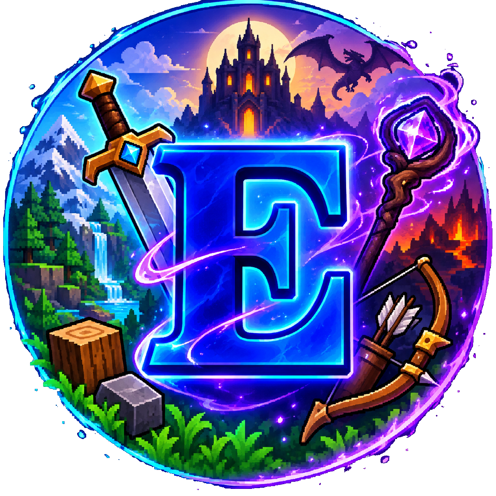

# [ ETERNAL NEXUS ]

- **Version:** Alpha
- **Created Date:** 27/09/2026
- **Engine:** Eternal Nexus Engine (Custom-built)

**Eternal Nexus** is an online multiplayer 2.5D fantasy adventure game set in a vast medieval world where players can meet, explore, fight, trade, survive and build their own legends.

The adventure begins on a central spawn island, a relatively safe place where players can meet and prepare for their journey. But once you leave the island, the world becomes far less predictable. The surrounding islands are dangerous territories where monsters roam, resources are waiting to be discovered, and other players may become either your greatest allies or your worst enemies.

---

## Development Status — Alpha Testing

**Eternal Nexus is currently in Alpha Testing.**

The game is being developed using **Eternal Nexus Engine**, our own custom-built game engine, designed specifically for the project.

Development is still ongoing, and the game is currently going through an active testing phase. New systems, mechanics and improvements are being developed, tested and refined along the way.

---

## ◈ Exploration & Adventure

- ▸ Explore a large world filled with islands, hidden locations and dangerous territories.
- ▸ Discover dungeons, abandoned structures, treasure locations and other places worth exploring.
- ▸ Unlock new islands by completing increasingly difficult dungeons.
- ▸ Each new island offers larger territories, stronger enemies, better loot and greater challenges.
- ▸ Encounter powerful bosses guarding valuable rewards.

## ◈ Combat & Progression

- ▸ Fight different types of mobs, monsters and powerful bosses.
- ▸ Develop your character through class-specific skill trees.
- ▸ Unlock new abilities and improve your combat potential.
- ▸ Discover rare weapons, armor, equipment and special items.
- ▸ Experience epic fantasy battles involving magic, unique weapons and different fighting styles.

## ◈ Crafting & Equipment

- ▸ Gather resources throughout the world.
- ▸ Craft weapons, armor, equipment and useful items.
- ▸ Discover rare materials and valuable loot.
- ▸ Improve your character's equipment to survive more dangerous territories.

## ◈ Multiplayer, Clans & PvP

- ▸ Meet and interact with other players in a shared online world.
- ▸ Create groups to explore and fight together.
- ▸ Form clans, build alliances or compete against other players.
- ▸ Fight for resources, territory and valuable rewards.
- ▸ Large-scale PvP battles and clan wars are planned features.

The world outside the spawn island is not governed by any strict rules. Trust is earned, alliances can change, and conflicts can emerge at any moment.

## ◈ Guild & Ranking System ♛

- ▸ Join the Guild and complete missions.
- ▸ Increase your Guild rank through your achievements.
- ▸ Earn rewards and unlock new opportunities.
- ▸ Build your reputation and climb the global leaderboard.

Your progress, achievements and actions will help define your place in the world.

---

## ◆ Main Features & Vision

Eternal Nexus aims to combine exploration, RPG progression, crafting, dungeon crawling and large-scale multiplayer combat into one evolving fantasy world.

Whether you prefer exploring unknown islands, hunting rare loot, developing your character, fighting bosses, completing Guild missions or taking part in massive clan wars, there is always something to pursue.

**There is no single path to follow. Explore, grow stronger, make alliances, take risks and decide what kind of adventurer you want to become.**

*Your journey begins on the Spawn Island. Everything beyond it is up to you.*

---

## ✦ Main Tags

`Adventure` `Fantasy World` `2.5D` `Online Multiplayer` `Epic Combat` `Dungeons` `RPG Progression` `Skill Trees` `Crafting` `Exploration` `PvP` `Clan Wars` `Boss Fights` `Loot System` `Magic`

---

**» Eternal Nexus — Your adventure. Your legend.**
